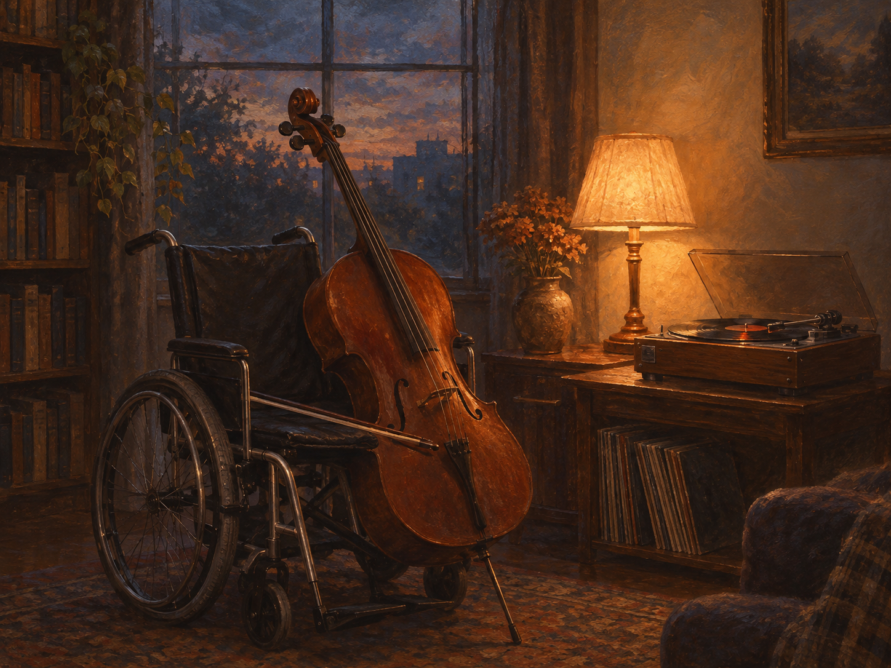

# Hilary and Jackie

In *Hilary and Jackie* (1998), directed by Anand Tucker, Edward Elgar's Cello Concerto in E minor (1919), written just after the First World War, is heard throughout the film. It is the very piece that made Jackie, the real-life cellist Jacqueline du Pré, famous. In the first half of the film, she plays it on concert stages around the world. Late in the film, Jackie, who now uses a wheelchair because of multiple sclerosis, listens to [a recording of herself playing the concerto's Adagio](https://www.youtube.com/watch?v=Au7vPQ2VpVE) and breaks down. In this short, slow movement, the cello sings a quiet melody almost without pause over a hushed orchestra, as if talking to itself. The beautiful sound she once made herself is now something she can only hear on a recording, a loss also faced by [another cellist with a neurological disease](./son-minseok.md). As she listens, Jackie faces two versions of herself side by side: who she is now, and the remembered self she has lost to the disease. In this scene, illness comes across not as a diagnosis but as the experience of losing her own voice, and the concerto becomes Jackie's illness narrative. But whose narrative is it? The film is based on a memoir written by her sister and brother, *A Genius in the Family* (1997), and some of du Pré's friends publicly objected that it did not show the Jacqueline they knew. The film keeps the family's version of Jackie's affair with Hilary's husband, a version Hilary's own daughter called a gross misinterpretation. Her own voice remains in recordings like the one Jackie hears on screen, and in a 1980 interview filmed by Christopher Nupen. So we are left asking whether what we hear is Jackie's own voice or the Jackie her family remembers.

# 힐러리와 재키

아난드 터커 감독의 《힐러리와 재키》(1998)에는 에드워드 엘가가 1차 세계대전 직후에 쓴 《첼로 협주곡 마단조》(1919)가 영화 곳곳에서 흘러나온다. 실존 첼리스트 재클린 뒤 프레, 이후 재키를 세상에 알린 바로 그 곡이다. 영화 전반부에서 재키는 이 곡을 들고 세계 무대에 선다. 영화 후반, 다발성 경화증으로 휠체어를 타게 된 재키는 자신이 연주한 [이 협주곡의 아다지오 녹음](https://www.youtube.com/watch?v=Au7vPQ2VpVE)을 듣다 무너져 내린다. 짧고 느린 이 악장에서 첼로는 숨죽인 오케스트라 위로 조용한 선율을 거의 쉬지 않고 이어 가며 혼잣말하듯 노래한다. 한때 자기가 연주한 아름다운 소리를 이제는 녹음으로만 들을 수 있다. [신경계 질환을 앓는 또 다른 첼리스트](./son-minseok.md)도 겪은 상실이다. 그 소리를 청취하는 동안 재키는 지금의 자신과, 병으로 잃어버린 기억 속의 자신을 나란히 마주한다. 이 장면에서 질병은 진단명이 아니라 자기 목소리를 잃는 경험으로 다가오고, 협주곡은 재키의 질환서사가 된다. 그렇다면 이 서사는 누구의 것일까? 이 영화는 언니와 남동생이 쓴 회고록 A Genius in the Family(1997)를 바탕으로 만들어졌고, 뒤 프레의 친구 몇몇은 자신들이 알던 재클린이 아니라며 공개적으로 반발했다. 영화는 재키가 힐러리의 남편과 관계를 맺었다는 가족의 이야기도 그대로 따르는데, 힐러리의 딸조차 이를 오해라고 반박했다. 뒤 프레 자신의 목소리는 영화 속 재키가 듣는 것과 같은 녹음들, 그리고 크리스토퍼 누펜이 1980년에 촬영한 인터뷰에 남아 있다. 이렇게 우리가 듣고 있는 것은 재키 자신의 목소리일까, 아니면 가족이 기억하는 재키일까 질문을 던지게 된다.
