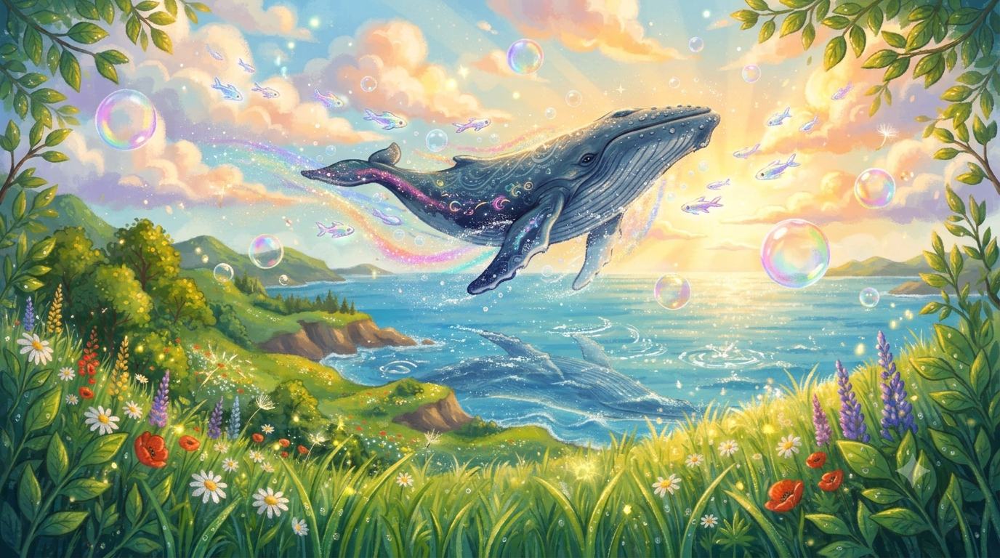

# Extraordinary Attorney Woo

In the drama *Extraordinary Attorney Woo* (2022), the OST [*Beyond My Dreams*](https://youtu.be/LPZDKf29IRs?si=g7nzC97ZaXX-cJXm) is often used in scenes where the main character, who is on [the autism spectrum](./cho-yuna.md), has difficulty communicating with others or becomes absorbed in her own thoughts. In particular, the scene where Woo Young-woo struggles to pass through the revolving door can be connected to the triple-meter rhythm of a piece like a waltz. The steady, repetitive rotation of the revolving door and the three-beat rhythm musically express Woo Young-woo's efforts to grasp the flow of an unfamiliar environment and adapt to everyday life at her own pace. In addition, the whales that fill Woo Young-woo’s mind are more than just something she likes. They serve as a way for her to find clues to solving problems in a complicated reality and to feel at peace. The natural images in the lyrics, such as clouds, sunlight, grass, and the sea, express the sense of calmness and innocence she experiences in her own world of imagination. Here, pure sensibility refers to an attitude of responding honestly to what one likes and feeling joy and comfort by picturing scenes of nature. In particular, the references to whales and the sea further show how Woo Young-woo sees and imagines the world in her own way, even when facing difficulties in everyday life. In this way, [*Beyond My Dreams*](./jang-kunmyung.md) focuses less on the main character’s exceptional abilities or genius and instead portrays her innocent personality and the importance of her own inner world. Rather than presenting disability simply as something to overcome or as a special ability, the song shows how one person experiences and understands the world in her own unique way.

# 이상한 변호사 우영우

드라마 《이상한 변호사 우영우》(2022)에서 [자폐 스펙트럼 장애](./cho-yuna.md)를 가진 주인공이 다른 사람들과 소통하는 데 어려움을 느끼거나 자신만의 생각에 빠져드는 장면에는 OST [〈상상〉](https://youtu.be/LPZDKf29IRs?si=g7nzC97ZaXX-cJXm))이 주로 사용된다. 특히 우영우가 회전문을 통과하기 어려워하는 장면은왈츠와 같은 곡의 3박자 리듬과 연결해 볼 수 있다. 회전문이 일정한 속도로 반복해서 회전하는 모습과 3박자의 리듬은 우영우가 낯선 환경의 흐름을 파악하고 자신만의 속도로 일상에 적응하려는 모습을 음악적으로 표현한다. 또한 우영우의 머릿속을 가득 채운 고래는 단순히 좋아하는 대상을 넘어 복잡한 현실 속에서 문제의 실마리를 찾고 마음의 안정을 얻는 매개체로 그려진다. 가사에 등장하는 구름, 햇살, 풀잎, 바다와 같은 자연의 이미지는 우영우가 자신만의 상상 속에서 느끼는 평온함과 순수한 감성을 드러낸다. 여기서 순수한 감성은 자신이 좋아하는 것에 솔직하게 반응하고 자연의 모습을 떠올리며 즐거움과 편안함을 느끼는 태도를 의미한다. 특히 고래와 바다를 연상시키는 표현은 우영우가 현실의 어려움 속에서도 자신만의 방식으로 세상을 바라보고 상상하는 모습을 더욱 잘 보여 준다. 이처럼 [〈상상〉](./jang-kunmyung.md)은 주인공의 특별한 능력이나 천재성만을 강조하기보다, 자신만의 세계를 소중히 여기는 순수한 모습을 담아낸다. 이를 통해 장애를 단순히 극복해야 할 어려움이나 특별한 능력으로 바라보는 것이 아니라, 한 사람이 자신만의 방식으로 세상을 경험하고 받아들이는 모습을 표현한다는 점에서 의미가 있다.

