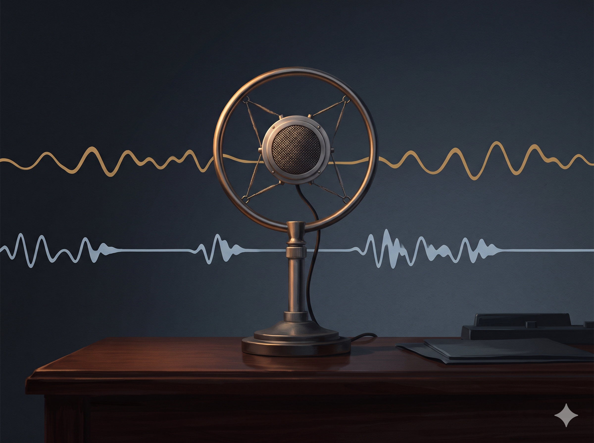

# The King's Speech

In Tom Hooper’s *The King’s Speech* (2010), the second movement of Beethoven’s *Symphony No. 7* accompanies [George VI’s radio address](https://www.youtube.com/watch?v=92upyRGrn44). The lower strings repeat the same rhythm while the king stops several times mid-speech. I noticed those silences more than the music. With the accompaniment still going, even a short wait for his next word felt long. Later, as more parts join and the sound grows fuller, the music seems to carry on toward the final sentence even when the king pauses. Following that momentum, it is easy to hear the end of the speech as a victory over stuttering. Yet the king did not choose this music. The sense of achievement the audience feels tells us little about the time it took him to say each word. The example of correcting finger movements that we discussed in class made me wonder what counts as a good speech. Just as we might assume there is a proper way to move our fingers, do we take it for granted that a good speaker gets through a sentence without pausing? Read alongside [an essay on *Sound of Metal*](./choi-seeun.md) that treats silence as part of accepting disability, the scene gives listening a concrete meaning. Before we celebrate the end of the address, we can wait for the king to say his next word.

# 킹스 스피치

톰 후퍼 감독의 킹스 스피치(2010)에서 [조지 6세가 라디오 연설을 하는 장면](https://www.youtube.com/watch?v=92upyRGrn44)에는 베토벤 교향곡 제7번 제2악장이 흐른다. 낮은 현악기가 같은 리듬을 되풀이하는 동안 왕은 말을 하다 몇 번씩 멈춘다. 내게는 음악보다 그 침묵이 더 신경 쓰였다. 반주는 계속되는데 목소리만 들리지 않으니 다음 한마디가 나오기까지의 짧은 틈도 길게 느껴졌다. 연설 후반에 다른 성부가 겹쳐 소리가 커지면, 왕이 멈춘 사이에도 음악은 마지막 문장을 향해 나아가는 듯하다. 그 흐름을 따라 듣다 보면 연설을 끝냈다는 사실이 말더듬까지 이겨 냈다는 뜻처럼 들릴 수 있다. 하지만 그때의 음악은 왕이 고른 것이 아니다. 관객이 느끼는 성취감과 왕이 한마디를 꺼내는 데 들인 시간은 다르다. 수업에서 다룬 손가락 교정 사례를 떠올리면, 이 연설을 평가하는 기준도 돌아보게 된다. 손가락을 움직이는 데 올바른 방식이 있다고 여기는 것처럼, 듣는 사람도 모르는 사이에 막힘없이 말하는 것을 좋은 연설의 기준으로 삼고 있지는 않을까. 침묵을 장애 수용의 일부로 읽은 [사운드 오브 메탈에 관한 글](./choi-seeun.md)과 함께 보면, 이 장면에서 청취가 무엇인지 더 분명해진다. 왕이 연설을 끝냈을 때의 감동에 앞서, 그가 다음 말을 꺼낼 때까지 기다리는 일이다.
