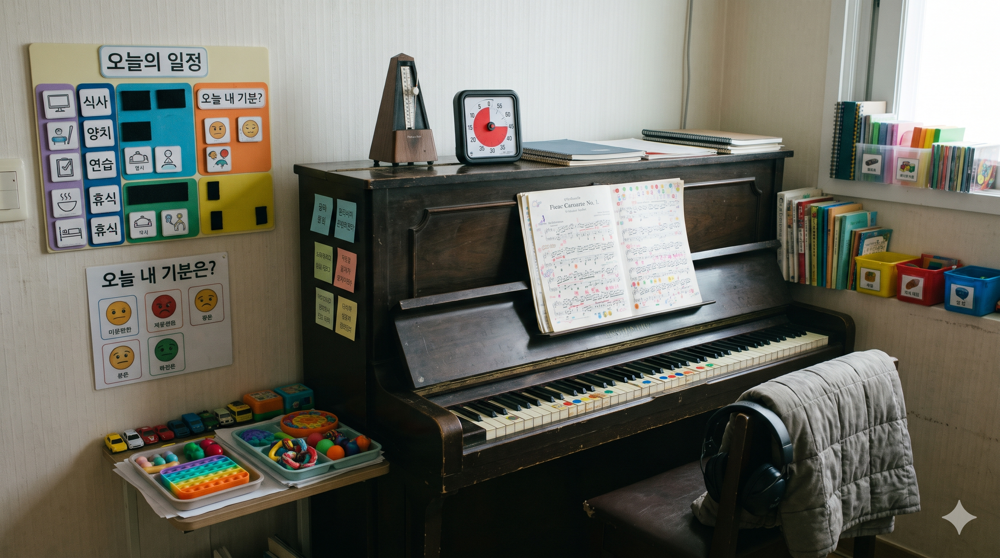

# Keys to the Heart
In *Keys to the Heart* (2018), directed by Choi-Sunghyun, the narrative centers on Jintae, a young man living with autism spectrum disorder and savant syndrome whose communicative agency is realized through the piano. During the film's climactic gala concert, Jintae performs the *Piano Concerto No. 1* by Pyotr Ilyich Tchaikovsky (1840–1893) alongside a full symphony orchestra. Rather than treating autism as a mere clinical lack or framing savant virtuosity as an inspirational spectacle, the film employs the concerto's expansive lyrical architecture to sonicize an embodied illness narrative. Where normative linguistic speech falters and social isolation threatens, the visceral, tactile labor of Jintae's performance enters into an equitable, reciprocal dialogue with the orchestral apparatus, demonstrating how musical sound can dismantle ableist boundaries and affirm the profound emotional depth and human dignity of the neurodivergent body. To include a link to a key moment worth watching together, this vivid musical exchange can be experienced directly in the [gala concert performance of Tchaikovsky's *Piano Concerto No. 1*](https://www.youtube.com/watch?v=jiQyA9bMHjc&t=383s). This scene also resonates with [*Twinkling Watermelon*](./kim-bokyoung.md), which explores musical communication beyond auditory and linguistic norms.

# 그것만이 내 세상

최성현 감독의 《그것만이 내 세상》(2018)에서 자폐 스펙트럼 장애와 서번트 증후군을 지닌 주인공 진태는 언어적 소통의 한계를 피아노 연주를 통해 극복한다. 영화의 절정인 갈라 콘서트에서 진태는 표트르 일리치 차이콥스키(1840–1893)의 〈피아노 협주곡 1번〉을 대규모 오케스트라와 함께 협연한다. 이 작품은 비장애중심주의 사회가 '결핍'이나 '비정상'으로 환원하던 신경다양성 신체를 단순한 동정이나 감상적 볼거리로 소비하지 않고, 협주곡의 서정적이고 웅장한 선율을 통해 주체적인 신체화된 질환서사로 재구성한다. 일상적인 구어 발화가 단절된 자리에서 오케스트라와 대등하게 호흡하는 진태의 타건은 장애가 지닌 감각적 단절을 넘어 세계와 깊이 교감하고 인간적 존엄을 입증하는 가장 강력한 음악적 발화로 기능한다. 영상으로 함께 보면 좋은 지점을 링크로 덧붙이자면, 이러한 대등한 음악적 대화와 울림은 [〈피아노 협주곡 1번〉 갈라 콘서트 협연 장면](https://www.youtube.com/watch?v=jiQyA9bMHjc&t=383s)에서 생생하게 확인할 수 있다. 청각과 언어의 규범을 넘어선 음악적 소통을 다룬 [《반짝이는 워터멜론》](./kim-bokyoung.md)과 함께 읽으면 좋다.

