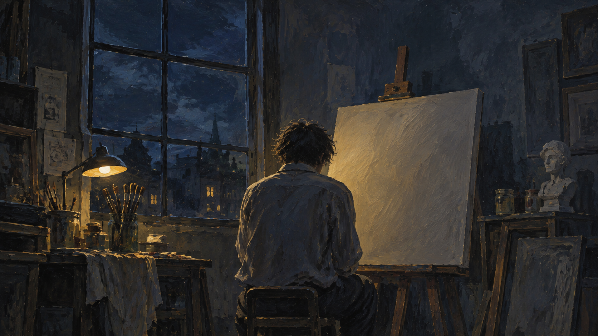

# Loving Vincent
In *Loving Vincent*(2017), directed by Dorota Kobiela and Hugh Welchman, Armand Roulin travels to Auvers-sur-Oise to solve the mystery of Vincent van Gogh's tragic death. As he uncovers Gogh's worrying struggle with severe depression and mental breakdown, ["Starry Starry Night"](https://www.youtube.com/watch?v=ifXkayutL9o&list=RDifXkayutL9o&start_radio=1) from Don McLean plays through the paintings. The fragile, shaky strings and barren piano notes capture the internal confusion and profound isolation he experienced. The film shows that what ultimately drove Van Gogh to his death was not merely his mental illness, but [the limits of a  society](./ko-yeongwoo.md) that fail to comprehend the depth of his pain - seen in the cold indifference of neighborhood who dismissed his suffering as madness and turned away. And it also shows that music and art together can convey an experience of madness and suffering that words alone cannot.

# 러빙 빈센트
도로타 코비엘라와 휴웰치먼 감독의 영화 러빙 빈센트(2017)에서, 아르맹 루랭은 빈센트 반 고흐의 비극적인 죽음에 얽힌 수수께끼를 풀기 위해 오베르쉬르우아즈로 향한다. 그가 심각한 우울증과 신경쇠약 속에서 괴로워하던 고흐의 고통스러운 투병 과정을 파헤치는 동안, 돈 맥클린의 [Starry Starry Night](https://www.youtube.com/watch?v=ifXkayutL9o&list=RDifXkayutL9o&start_radio=1)가 그림 사이로 흘러 나온다. 위태롭게 떨리는 현악 선율과 쓸쓸한 피아노 음은 고흐가 느꼈던 내면의 혼란과 극심한 고독을 나타낸다. 영화는 고흐를 결국 죽음으로 몰고 간 것이 단지 그의 정신 질환 때문만이 아니라 그의 고통을 광기라고 치부하며 외면했던 마을 사람들의 냉담한 시선 등이 지닌 깊이를 이해하지 못한 [사회의 한계](./ko-yeongwoo.md)였음을 보여주며, 음악과 예술이 결합되었을 때 언어만으로는 다 담아낼 수 없는 광기와 고통의 경험을 전할 수 있음을 시사한다.

