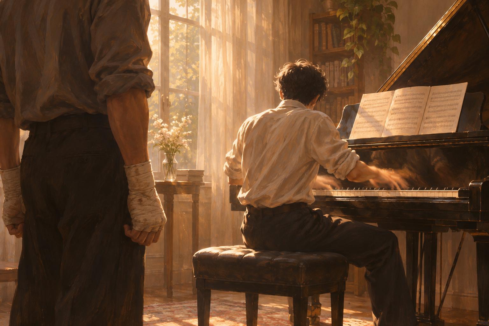

# Keys to the Heart

In *Keys to the Heart* (2018), directed by Choi Sung-hyun, Jo-ha, a former boxing champion, reunites with his mother after 17 years apart and unexpectedly meets his younger brother Jin-tae at her home. Although their different ways of living create conflict, the brothers gradually come to understand each other, partly through Jin-tae's piano playing. Jin-tae is portrayed as having autism spectrum disorder with savant abilities in piano performance. At Ga-yul's home, he plays the third movement, “Rondo: Vivace,” of *Piano Concerto No. 1 in E minor, Op. 11* by Frédéric Chopin (1810–1849), which can be heard in [Seong-Jin Cho's performance at the 2015 Chopin Competition](https://www.youtube.com/watch?v=614oSsDS734&t=1840s). Its lively rhythms and brilliant piano technique encourage viewers to see Jin-tae as a person with his own expressive abilities, rather than only as someone with autism who needs support from others. Connecting this scene with the concept of listening discussed in class, I think listening to his performance can become a way of understanding what he expresses rather than judging him solely by his disability. At the same time, the audience's admiration for his musical talent makes me wonder whether the film encourages viewers to accept people with disabilities primarily as exceptional geniuses. Such a view can suggest that a disabled person deserves attention only when he shows an extraordinary ability, and it risks overlooking the many autistic people who have no special talent. It can also reduce Jin-tae to his gift and hide his everyday feelings and relationships. This scene made me feel that everyone deserves respect, regardless of whether they have a disability or an exceptional talent. Music also shapes how people relate to one another in [A Late Quartet](./kim-yongmin.md), where playing the cello connects Peter to the other musicians.

# 그것만이 내 세상

최성현 감독의 《그것만이 내 세상》(2018)에서 전직 복서 챔피언인 주인공 조하는 17년 만에 헤어진 엄마와 재회하고 집에서 뜻밖의 동생인 진태와 마주한다. 서로 다른 방식으로 살아온 형제는 함께 지내며 갈등을 겪지만, 진태의 피아노 연주 등을 통해 조금씩 서로를 이해하게 된다. 진태는 피아노 연주에 서번트 능력이 있는 자폐 스펙트럼 장애를 가진 인물로 묘사된다. 가율의 집에서 진태가 연주하는 곡은 프레데리크 쇼팽(1810-1849)의 《피아노 협주곡 제1번 마단조, 작품번호 11》 제3악장 「론도: 비바체」이며, [2015년 쇼팽 콩쿠르 결선에서 조성진이 연주한 영상](https://www.youtube.com/watch?v=614oSsDS734&t=1840s)으로 들어 볼 수 있다. 빠르고 경쾌한 리듬과 화려한 피아노 기교는 진태를 주변의 도움을 받는 자폐 스펙트럼 장애를 가진 인물이 아닌, 자신만의 표현 능력을 가진 사람으로 보게 한다. 수업에서 다룬 청취의 개념과 연결하면, 그의 연주를 듣는 일은 장애만으로 그를 판단하기보다 그가 표현하는 것을 이해하려는 과정이 될 수 있다고 생각한다. 동시에 관객이 그의 음악적 재능에 감탄하는 방식이 장애인을 특별한 천재로 받아들이게 하는 것은 아닌지도 생각하게 된다. 이런 시선은 장애인이 뛰어난 능력을 보여 줄 때만 주목받을 가치가 있다는 인식으로 이어질 수 있고, 특별한 재능이 없는 많은 자폐인을 보이지 않게 만들 위험이 있다. 또한 진태를 재능으로만 바라보게 해서 그의 일상적인 감정과 관계를 가리기도 한다. 나는 이 장면을 통해 장애 또는 뛰어난 재능이 있든 없든 한 사람을 존중하는 일이 중요하다 느꼈다. 음악이 사람 사이의 관계를 이어 주는 모습은 [마지막 4중주](./kim-yongmin.md)에서도 볼 수 있다.
