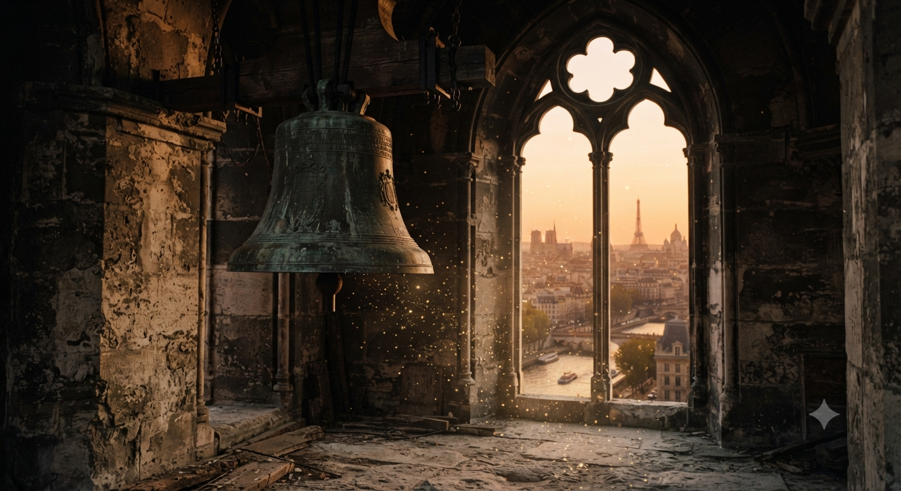

# The Hunchback of Notre Dame

In Disney’s *The Hunchback of Notre Dame* (1996), directed by Gary Trousdale and Kirk Wise, Quasimodo, who is kept in the bell tower because of his hunched back and twisted face, sings ["Out There"](https://www.youtube.com/watch?v=S7YP6onNlXc) on the morning of the Festival of Fools. In the first part of the song, Frollo tells him in a low, heavy voice that he is deformed and ugly and that the world will never accept him, and Quasimodo repeats these words, taking society’s prejudice as his own. After Frollo leaves, Quasimodo’s part begins quietly as he looks down from behind the stone windows and sings that he knows the faces of the people below, though they will never know him. As he imagines walking among them, the melody climbs higher and the orchestra swells, until he cries out that he wants to spend just one day "not above them, but part of them." I think this change from a hushed, lonely tone to a bright, soaring one shows people’s prejudice toward people with disabilities, but at the same time it shows a small hope that stands against it and the possibility that things can get better. Just as Stephen Hawking finds a new way to speak in [another film about finding a new voice through illness](./kim-sungeun.md), Quasimodo finds his own voice through this song. In the final scene, his wish is partly fulfilled: as the bells ring and the choir returns with the opening song, a little girl gently touches his face, and the crowd that once mocked him cheers and welcomes him. The music now asks what makes a monster and what makes a man, the same question the film began with, and this time the answer seems to point to Frollo rather than Quasimodo. However, Esmeralda, the kind Romani woman who was the first to stand up for Quasimodo at the festival, falls in love with Captain Phoebus, and Quasimodo joins their hands and blesses them. The film does not say that she turns away from him because of his disability, and the ending comes from the relationships and choices between the characters. Still, the fact that the main character with a disability is accepted as a hero but remains a helper rather than someone who is loved leaves a bitter aftertaste, as it seems to show that reality is still harsh for people with disabilities.

# 노틀담의 꼽추

게리 트러스데일과 커크 와이즈 감독의 디즈니 애니메이션 《노틀담의 꼽추》(1996)에서, 등이 굽고 얼굴이 일그러졌다는 이유로 종탑에 갇혀 사는 콰지모도는 바보들의 축제 날 아침 [「Out There」](https://www.youtube.com/watch?v=S7YP6onNlXc)를 부른다. 곡의 앞부분에서 프롤로는 낮고 무거운 목소리로 콰지모도에게 너는 기형이고 추하니 세상은 너를 받아주지 않을 것이라 말하고, 콰지모도는 그 말을 그대로 따라 부르며 차별의 시선을 자기 것으로 받아들인다. 프롤로가 떠난 뒤 콰지모도의 파트는 돌창 너머로 사람들을 내려다보며, 자신은 그들의 얼굴을 다 알지만 그들은 자신을 영영 모를 것이라고 조용히 노래하는 것으로 시작한다. 그러다 사람들 사이를 걷는 모습을 상상하면서 멜로디가 점점 높아지고 오케스트라가 커지며, 단 하루만이라도 사람들 "위가 아니라 그들의 일부로" 살고 싶다고 외치듯 노래한다. 이렇게 낮고 외로운 분위기에서 밝고 벅찬 분위기로 바뀌는 노래는 장애인을 향한 사람들의 편견을 보여주는 동시에, 그 편견에 맞서는 작은 희망과 더 나아질 수 있다는 가능성도 함께 보여준다고 생각한다. [질병 속에서 새로운 목소리를 찾아가는 다른 영화](./kim-sungeun.md)에서 스티븐 호킹이 새로운 방식으로 말하게 되는 것처럼, 콰지모도도 이 노래를 통해 자기 목소리를 찾아간다. 마지막 장면에서 이 바람은 어느 정도 이루어진다. 종소리와 함께 오프닝 곡이 합창으로 다시 울려 퍼지는 가운데, 한 아이가 콰지모도의 얼굴을 어루만지고 한때 그를 조롱하던 군중은 환호하며 그를 받아들인다. 이때 노래는 영화 첫 장면과 같은 질문, 즉 무엇이 괴물을 만들고 무엇이 사람을 만드는지를 다시 묻는데, 이번에는 그 답이 콰지모도가 아니라 프롤로를 가리키는 것처럼 느껴진다. 하지만 축제에서 조롱당하던 콰지모도를 처음으로 감싸 준 집시 여인 에스메랄다는 근위대장 페뷔스와 사랑에 빠지고, 콰지모도는 두 사람의 손을 이어 주며 축복하는 자리에 머문다. 영화 속에서 에스메랄다의 선택이 콰지모도의 장애 때문이라고 직접 나오지는 않으며, 이는 인물들 사이의 관계와 선택에 따른 결말이다. 그럼에도 장애를 가진 주인공이 영웅으로는 인정받지만 사랑받는 사람이 아닌 조력자로 남는다는 점에서, 장애인에게는 여전히 현실이 각박하다는 생각이 들어 씁쓸함이 남는다.

