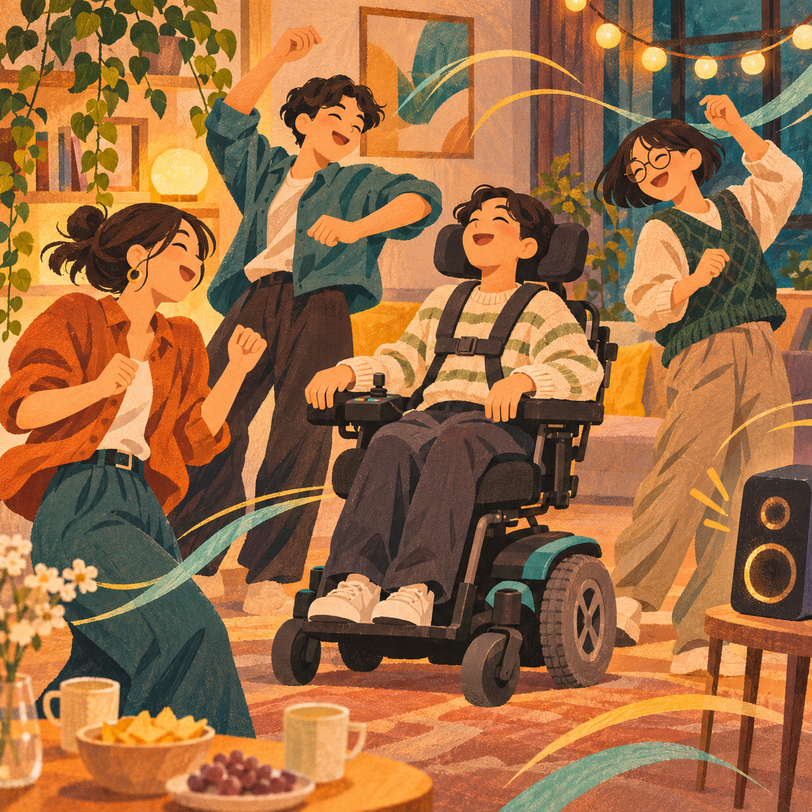

# The Intouchables

In *The Intouchables* (2011), the birthday party scene in which Driss dances to “Boogie Wonderland” invites reflection on how we view people with disabilities. I was struck by how Philippe, who has tetraplegia, participates in the enjoyment without having to move in the same way as the people around him. The transition from the preceding classical performance to “Boogie Wonderland” shifts the scene’s emphasis from listening to a performance toward sharing in the activity of dancing. I interpret this contrast as a change in how people interact within this particular scene, rather than as an inherent difference between classical music and dance music.

The song’s lively, repetitive beat gives Driss’s dancing a steady pulse and creates an atmosphere of shared enjoyment. As Philippe watches Driss dance and smiles, his facial expression offers a different way of participating alongside the movements of the people around him. For me, the connection between the music, dancing, and Philippe’s response makes him visible as a participant in the pleasure of the occasion rather than merely as an object of pity. Imagining the scene from Philippe’s perspective, I read this moment as an opportunity to enjoy others’ company without being defined solely by disability.

This connects to the concepts of normality and normativity discussed in class: treating nondisabled bodies and behavior as “normal,” and expecting everyone to conform to that standard. If dancing in the same way were the measure of participation, Philippe’s enjoyment could be overlooked. Recognizing his different way of engaging challenges that expectation. In this scene, music does not remove disability; instead, it changes the way we view people with disabilities and what we recognize as participation.

Watch [Driss dance to “Boogie Wonderland” at Philippe’s birthday party](https://www.youtube.com/watch?v=yxefieJKFPw).

For a related discussion, see [Hayoung Kwon’s entry on *The King’s Speech*](./kwon-hayoung.md), which examines how music changes the audience’s perception of a voice affected by stuttering. While *The King’s Speech* emphasizes the dignity of a public speech, *The Intouchables* highlights equal participation in shared enjoyment.

# 언터처블: 1%의 우정

《언터처블: 1%의 우정》(2011)의 생일 파티에서 드리스가 「Boogie Wonderland」에 맞춰 춤추는 장면은 장애인을 바라보는 시선에 대해 생각하게 한다. 나는 사지마비가 있는 필리프가 주변 사람들과 같은 방식으로 몸을 움직이지 않아도 그 즐거움에 참여한다는 점이 인상 깊었다. 앞선 클래식 연주에서 「Boogie Wonderland」로 전환되면서, 장면의 중심은 연주를 듣는 데서 춤을 매개로 즐거움을 함께 나누는 데로 옮겨간다. 나는 이러한 대비를 클래식과 댄스 음악의 본질적인 차이라기보다, 이 장면에서 사람들이 서로 어울리는 방식의 변화로 해석했다.

곡의 경쾌하고 반복적인 박자는 드리스의 춤에 일정한 맥박을 부여하며 함께 즐기는 분위기를 만든다. 드리스의 춤을 보며 미소 짓는 필리프의 표정은 주변 사람들의 움직임과 나란히 놓이면서, 그가 다른 방식으로 이 순간에 참여하고 있음을 보여준다. 나는 음악과 춤, 필리프의 반응이 어우러지는 모습을 통해 그를 단순한 연민의 대상보다 파티의 즐거움을 함께 나누는 사람으로 바라보게 되었다. 필리프의 입장에서 상상해 보면, 이 순간은 장애만으로 자신을 규정하는 시선에서 벗어나 다른 사람들과 어울리는 기회처럼 다가왔다.

이는 수업에서 다룬 정상성과 규범성 논의와 연결된다. 비장애인의 신체와 행동을 ‘정상’으로 간주하는 것과, 모두에게 그 기준에 맞추도록 요구하는 것은 이 장면을 해석할 때 돌아볼 지점이다. 같은 방식으로 춤추는 것만을 참여의 기준으로 삼으면 필리프의 즐거움을 놓칠 수 있다. 그가 다른 방식으로 함께하고 있음을 인정하는 것은 이러한 기대에 의문을 제기한다. 이 장면에서 음악은 장애를 없애기보다 장애가 있는 사람을 바라보는 시선과 우리가 참여로 인정하는 방식에 변화를 준다.

[필리프의 생일 파티에서 드리스가 「Boogie Wonderland」에 맞춰 춤추는 장면](https://www.youtube.com/watch?v=yxefieJKFPw)을 감상할 수 있다.

관련된 논의로 [권하영의 《킹스 스피치》 글](./kwon-hayoung.md)을 함께 읽을 수 있다. 이 글은 음악이 말더듬이 있는 인물의 목소리를 관객이 받아들이는 방식을 어떻게 바꾸는지 살펴본다. 《킹스 스피치》가 대중 앞에서 하는 연설의 존엄성에 주목한다면, 《언터처블: 1%의 우정》은 함께 즐거움을 나누는 동등한 참여에 주목한다.
