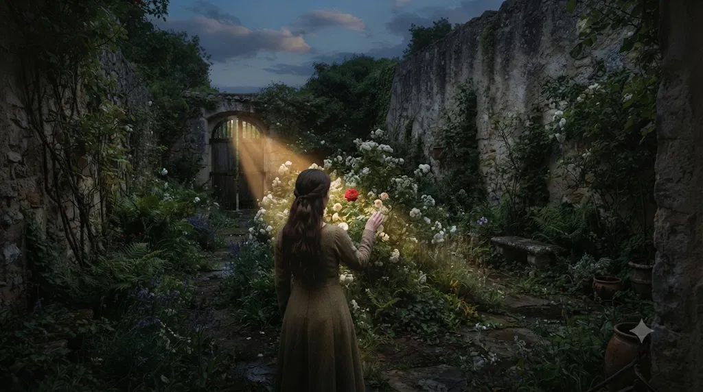

# Iolanta

In *Iolanta* (1892), a one-act lyric opera by Pyotr Ilyich Tchaikovsky (1840–1893) with a libretto by his brother Modest after Henrik Hertz's play *King René's Daughter* (1845), the blind princess Iolanta lives in a secluded garden, unaware of her blindness because her father, King René, forbids anyone to speak of sight or light. The physician Ibn-Hakia insists that she can be cured only if she knows her condition and wills to see. When the knight Vaudémont reveals her blindness and the king threatens his life, Iolanta longs to save him and regains her sight. The music casts blindness as "darkness" and sight as "light." The Introduction (Andante quasi Adagio) is scored only for woodwinds and horns, and without the sustained warmth of the strings, its quiet, reedy chords make her world of sound feel calm yet incomplete. In No. 1, Iolanta's Arioso "Otchego eto prezhde ne znala" ("Why did I never know before such longing, such sorrow?") voices an unnamed sense of lack. The Finale (No. 9) then closes with a hymn to light in which the full orchestra, now with strings, joins the chorus at full volume. This contrast in timbre and volume does not mean that a smaller ensemble is lacking in itself; rather, it reveals how the opera chooses to represent blindness through sound. Because the strings and full orchestra enter only at the moment of cure, the score hears Iolanta's world as incomplete until she sees, implying that what she lacks is something she herself must gain. In this way, the work presents disability as a deficiency to be fixed and cure as spiritual fulfillment, and by making healing depend on Iolanta's own will, it frames blindness as an individual problem to overcome. At the same time, the closed, string-less sound of the Introduction can also be heard as the world her father's silence has built. His concealment, which confines rather than protects her, invites reflection on the control exercised over disabled people in the name of care.

This contrast becomes clearer when read alongside [another film about a musician who loses his hearing](./kwon-minjae.md), which ends not in cure but in his choice to turn off his implant and accept silence.

You can watch [a full performance of *Iolanta* by the Royal Swedish Opera](https://www.youtube.com/watch?v=IMjVeCDtxG4).

# 이올란타

표트르 일리치 차이콥스키(1840–1893)가 작곡하고 동생 모데스트 차이콥스키가 헨리크 헤르츠의 희곡 『르네 왕의 딸』(1845)을 바탕으로 대본을 쓴 단막 서정 오페라 《이올란타》(1892)에서, 공주 이올란타는 앞을 보지 못하지만 아버지 르네 왕이 '보다'와 '빛'이라는 말을 금지한 탓에 자신의 장애를 모른 채 정원에 갇혀 산다. 의사 이븐하키아는 그녀가 자기 상태를 알고 스스로 보기를 원해야만 치료할 수 있다고 말한다. 기사 보데몽이 그녀의 장애를 알게 되고 왕이 치료에 실패하면 그를 처형하겠다고 위협하자, 이올란타는 그를 살리고 싶은 마음에 간절히 보기를 원하게 되고 마침내 시력을 얻는다. 이 작품에서 음악은 시각장애를 '어둠'으로, 시력을 '빛'으로 바꿔 들려준다. 〈서주(Andante quasi Adagio)〉는 현악기 없이 목관과 호른으로만 연주되는데, 현악기 특유의 지속적이고 따뜻한 울림이 빠진 채 조용히 이어지는 관악 화음은 그녀가 사는 소리의 세계를 차분하지만 무언가 빠진 세계처럼 들리게 한다. 〈제1번 이올란타의 아리오소〉("왜 예전에는 이런 그리움도, 이런 슬픔도 몰랐을까?")는 이름 붙일 수 없는 결핍을 노래하고, 〈제9번 피날레〉는 현악기가 더해진 오케스트라 전체와 합창이 최대 음량으로 부르는 빛의 찬가로 끝난다. 이러한 음색과 음량의 대비는 작은 편성 자체가 불완전하다는 뜻이 아니라, 이 작품이 시각장애를 소리로 어떻게 표현하는지를 보여 준다. 현악기와 오케스트라 전체가 치료의 순간에야 비로소 등장하기 때문에, 음악은 이올란타의 세계를 앞을 보게 되기 전까지 불완전한 것으로 들려주고, 그 빈자리를 그녀 스스로 채워야 할 것으로 암시한다. 이렇게 이 작품은 장애를 '고쳐야 할 결핍'으로, 치료를 '영적 완성'으로 그리며, 치료가 이올란타 자신의 의지에 달려 있다는 설정은 장애를 개인이 극복해야 할 문제로 만든다. 그러나 현악기 없이 닫혀 있는 서주의 소리는 아버지의 침묵이 만들어 낸 세계로도 들린다. 딸을 보호하기는커녕 가두어 버리는 이 침묵은 '돌봄'이라는 이름으로 장애인에게 가해지는 통제를 비판적으로 돌아보게 한다.

치료가 아니라 인공와우를 끄고 침묵을 받아들이는 선택으로 끝나는 [청력을 잃은 음악가에 관한 다른 영화](./kwon-minjae.md)와 함께 읽으면 이 대비가 더 뚜렷해진다.

[스웨덴 왕립 오페라의 《이올란타》 전막 공연](https://youtu.be/IMjVeCDtxG4?si=izuIBE9Q2lqanKqZ)을 감상할 수 있다.

