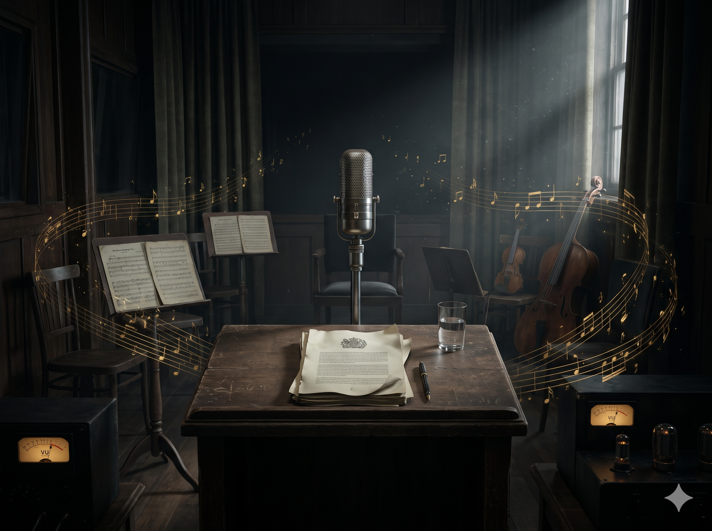

# The King's Speech

In *The King's Speech* (2010), directed by Tom Hooper, King George VI, who suffers from a severe stutter rooted in childhood abuse and debilitating performance anxiety, ascends the throne in 1936 and faces the outbreak of World War II, undergoing unorthodox speech therapy with Lionel Logue to deliver his crucial 1939 wartime radio broadcast against Germany. During this speech, the second movement (Allegretto) of Ludwig van Beethoven's (1770–1827) [Symphony No. 7 in A major, Op. 92](https://www.youtube.com/watch?v=W9UktXoM6Zw) underscores the scene as non-diegetic music, where the low strings' steady funeral-march rhythm guides the audience to stay attuned to the speech without losing its thread, filling the tense silences when the King blocks on plosive consonants and framing his spasmodic pauses as cadences of resolve. Rather than romanticizing his biological pathology or personal agony with sentimental melodies that smooth over his struggle, the restrained, heavy repetition of the low strings leaves his labored breathing exposed while sublimating his vulnerable voice into a weighty public declaration against the social stigma of speech flaws—though the narrative still leaves open the limitation of treating vocal fluency as the standard of overcoming disability. This scene also recalls [The Intouchables](./kim-yunsang.md), another film about shifting the gaze toward a person with a disability.

# 킹스 스피치

톰 후퍼 감독의 《킹스 스피치》(2010)에서 유년기 학대와 심리적 압박으로 극심한 말더듬증을 겪던 영국 국왕 조지 6세는 1936년 왕위에 오른 뒤 제2차 세계대전 발발이라는 국가적 위기 속에서 언어치료사 라이오넬 로그의 비전통적인 치료를 받으며 장애를 마주하고 1939년 대독 선전포고 대국민 라디오 연설을 감행한다. 연설이 진행되는 동안 극 바깥의 배경음악으로 루트비히 판 베토벤(1770–1827)의 [〈교향곡 제7번 가장조, 작품번호 92〉](https://www.youtube.com/watch?v=W9UktXoM6Zw) 2악장 알레그레토가 흐르며, 저음현의 규칙적인 장송 행진곡 리듬은 관객이 왕의 끊기는 발화 속에서도 흐름을 놓치지 않고 끝까지 집중해 듣도록 이끌어 파열음 앞에서 숨이 막히고 발화가 끊기는 긴장된 침묵의 순간들을 결연한 결의의 호흡으로 들리게 한다. 이 작품에서 음악은 감상적인 선율로 발화의 어려움을 미화하며 신체적 이상과 심리적 고통을 낭만화하는 대신, 절제되고 무거운 저음현의 반복을 통해 왕의 더딘 호흡을 그대로 드러낸 채 완벽한 언어만을 요구하는 사회적 낙인에 맞서 당사자의 떨리는 목소리를 공적 선언의 무게로 승화시키지만, 동시에 말의 유창성을 장애 극복의 기준으로 삼는 서사적 한계 역시 함께 성찰하게 한다. 장애를 갖고 있는 사람을 향한 시선의 전환을 다룬 [언터처블: 1%의 우정](./kim-yunsang.md)과 함께 읽으면 좋다.
