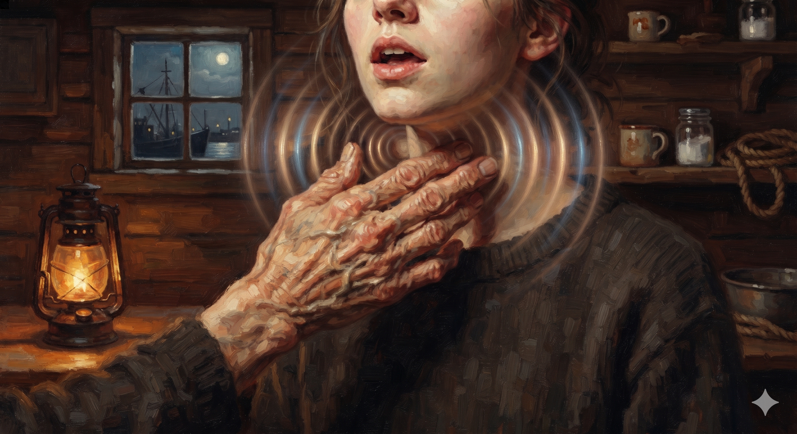

# CODA

In *CODA* (2021), directed by Siân Heder, Ruby Rossi is the only hearing member of a Deaf fishing family. At her school choir concert, Ruby and Miles sing ["You're All I Need to Get By,"](https://youtu.be/virfFCPdgek) a Motown duet first recorded by Marvin Gaye and Tammi Terrell in 1968. During the duet, the film suddenly drops the soundtrack and lets us experience the concert as Ruby's parents do: mouths move and the audience reacts, but there is no sound, so her parents look around at other listeners' faces to read the song. That night, her father Frank asks her to sing for him alone and rests his hand on her throat to feel her voice as vibration. The scene reverses the usual direction of disability representation. Instead of using music to make deafness audible for hearing viewers, the film takes the music away and puts hearing viewers inside the Deaf family's situated knowledge, an understanding shaped by one's lived position and bodily experience. What it reveals is not a lack of hearing but another way of listening, through the eyes and the body, which questions the audism that treats one "normal" way of hearing as the only one, a norm also at stake in [a film about a stammering king](./lee-chaeeun.md). Yet a diagnostic code would record Frank's way of listening, his hand on his daughter's throat, only as a sensory deficit, leaving out this embodied, relational way of hearing. So the scene also makes us ask whether filing this film under a diagnostic code for deafness can capture how a Deaf family understands its own experience.

# 코다

션 헤이더 감독의 《코다》(2021)에서 루비 로시는 농인(Deaf) 어부 가족 가운데 유일하게 들을 수 있는 사람이다. 학교 합창 발표회에서 루비와 마일스는 마빈 게이와 태미 테럴이 1968년에 처음 녹음한 모타운 듀엣곡 [「You're All I Need to Get By」](https://youtu.be/virfFCPdgek)를 부른다. 듀엣이 이어지는 도중 영화는 갑자기 소리를 지우고, 관객이 루비의 부모처럼 소리 없는 공연을 겪게 한다. 입은 움직이고 사람들은 반응하지만 소리는 없어서, 부모는 주변 관객의 표정을 살피며 노래를 읽어 낸다. 그날 밤 아버지 프랭크는 자기만을 위해 노래해 달라고 청하고, 딸의 목에 손을 얹어 목소리를 진동으로 느낀다. 이 장면은 장애 재현의 익숙한 방향을 뒤집는다. 음악으로 청각장애를 청인 관객에게 들려주는 대신, 음악을 빼앗아 청인 관객을 농인 가족의 '상황적 지식'(처한 자리와 몸의 경험에서 만들어지는 앎) 안에 세운다. 여기서 드러나는 것은 들음의 결핍이 아니라 눈과 몸으로 듣는 또 다른 청취 방식이며, 이는 하나의 '정상적' 청력만을 기준으로 삼는 청능주의(audism)에 질문을 던진다. 이 질문은 '정상적' 말하기를 다룬 [말을 더듬는 왕의 이야기](./lee-chaeeun.md)와도 맞닿아 있다. 하지만 진단 코드는 딸의 목에 손을 얹어 노래를 듣는 프랭크의 방식을 단지 청력의 결핍으로만 기록할 뿐, 이처럼 몸으로 관계 맺으며 듣는 방식을 담지 못한다. 그래서 이 장면은 이 작품을 청각장애 진단 코드로 분류하는 일이 농인 가족이 스스로 이해하는 자신의 경험을 온전히 담을 수 있는지도 묻게 한다.

