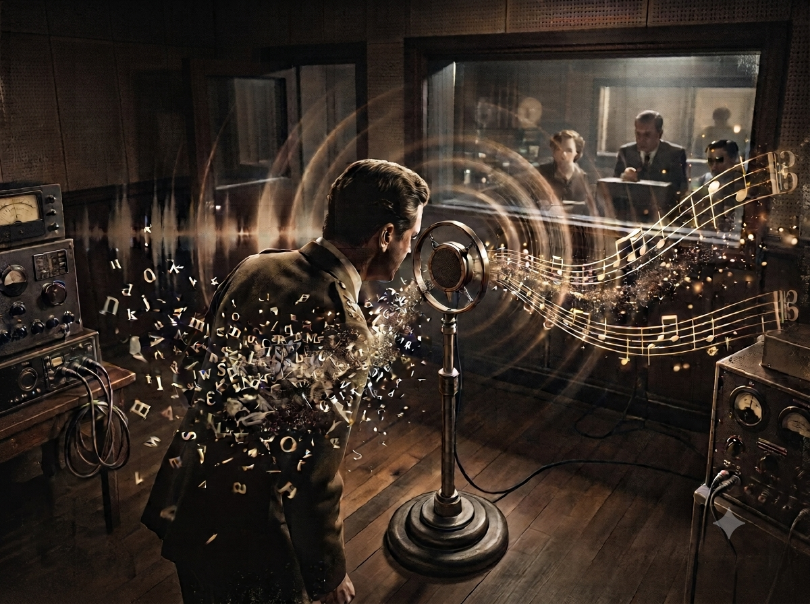

# The King's Speech

In *The King's Speech* (2010), directed by Tom Hooper, King George VI, who has stammered since childhood, broadcasts Britain's declaration of war on 3 September 1939, with his speech therapist Lionel Logue silently guiding him through each phrase. Beneath his voice plays the second movement, [Allegretto, of Beethoven's Symphony No. 7 in A major, Op. 92 (1812)](https://www.youtube.com/watch?v=XJ45tVkUefo). The movement opens with a held wind chord, followed by a quiet theme in A minor played by violas, cellos, and basses. This theme is built on one repeating rhythm (long, two short, long, long). Then the second violins join, the first violins add a countermelody, and the same pattern grows louder until the full orchestra is sounding. As this recurring rhythm fills the gaps in the king's speech, the stammer is heard as [a struggle being steadily overcome](./kim-sungeun.md), and the audience is invited to listen with him rather than merely hear him. At the same time, the crescendo seems to promise an arrival before he reaches it. Because this is a live wartime broadcast, in which the nation expects its king to speak in a steady, unbroken voice, that promise resonates with the public's hope that his stammer will disappear. The music can thus be heard as voicing a social demand for fluency. With the crescendo arriving before the king does, the scene leaves open whether the music gives voice to the king's own struggle or to the public's expectation.

# 킹스 스피치

톰 후퍼 감독의 《킹스 스피치》(2010)에서 어린 시절부터 말을 더듬어 온 조지 6세는 1939년 9월 3일 영국의 대독 선전포고를 라디오로 전하고 언어치료사 라이오넬 로그는 말없이 손짓으로 그의 한 구절 한 구절을 이끈다. 왕의 목소리 아래에서는 [베토벤 「교향곡 7번 A장조, 작품 92」(1812)의 2악장 알레그레토가 흐른다](https://www.youtube.com/watch?v=XJ45tVkUefo). 이 악장은 목관이 길게 붙든 화음으로 시작한다. 이어 비올라와 첼로, 콘트라베이스가 '길게-짧게 둘-길게-길게'의 한 가지 리듬을 되풀이하는 가단조의 낮은 주제를 조용히 들려준다. 여기에 제2바이올린이 겹치고 제1바이올린이 대선율을 더하면서 같은 리듬을 점점 키워 관현악 전체의 음량에 이른다. 이 되풀이되는 리듬이 왕의 말 끊김 사이를 메우는 동안 [말더듬은 점차 이겨 내는 과정으로 들리고](./kim-sungeun.md) 관객은 왕의 말을 그저 듣는 데 그치지 않고 함께 귀를 기울이는 청취로 이끌린다. 다만 크레센도는 왕이 닿기도 전에 도착점을 먼저 약속하는 듯하다. 이 장면이 전쟁을 선포하는 생방송이고 국민이 왕에게 막힘없는 목소리를 기대하는 자리라는 점에서, 이 약속은 더듬거림이 사라지길 바라는 대중의 기대와 맞닿아 있다고 느꼈다. 음악이 말더듬에 유창함을 요구하는 사회의 시선을 대변하는 것처럼 들릴 수 있기 때문이다. 그래서 크레센도가 왕보다 먼저 도착하는 이 장면에서, 이 음악이 왕 자신의 분투를 들려주는 것인지 대중의 기대를 들려주는 것인지는 열린 질문으로 남는다.

