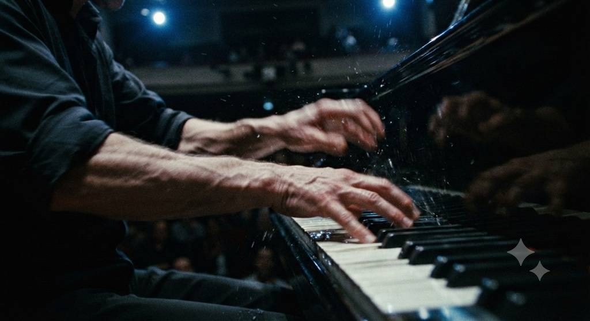

# Shine

In *Shine* (1996), directed by Scott Hicks, David Helfgott, a brilliant pianist shattered by his father’s oppressive control and severe mental illness, frantically performs Sergei Rachmaninoff’s [Piano Concerto No. 3](https://youtu.be/N29WamXg4pY?si=aZXnOA4M0nSMFAtg) on the Royal College of Music stage, collapsing from a psychotic breakdown just as the final chord fades. As the piece accelerates, its extreme technical demands and furious tempo collide with his father’s suffocating demand for perfection, while the surrounding orchestral sound suddenly grows muffled, leaving only his heavy breathing, heartbeat, and frantic keystrokes. Rather than [romanticizing suffering](./lee-seunghyeon.md) as a form of artistic sublimation, this auditory shift allows us to listen directly to [the voice of the sufferer](./lee-taejun.md), capturing his internal agony on the brink of a schizophrenic episode. By distinguishing clinical disease from the subjective, lived experience of illness, the film shows that music can convey a profoundly personal narrative of mental breakdown that words alone cannot.

# 샤인

스콧 힉스 감독의 《샤인》(1996)에서, 아버지의 억압적인 통제와 완벽주의로 상처 입은 피아니스트 데이비드 헬프갓은 런던 왕립음악원 무대에서 세르게이 라흐마니노프의 [피아노 협주곡 제3번](https://youtu.be/N29WamXg4pY?si=aZXnOA4M0nSMFAtg)을 폭풍처럼 연주해 낸 직후, 끝내 쓰러지며 정신적 붕괴를 일으킨다. 곡이 절정으로 치달을수록 극단적인 기교와 맹렬한 템포는 아버지가 강요한 완벽주의 규범과 충돌하고, 주변의 오케스트라 소리는 먹먹하게 잦아들며 그의 거친 숨소리와 심장 박동, 피아노 건반 소리만이 남는다. 이러한 음향적 전환은 고통을 예술적 성취로 승화시킨다는 미명 아래 [환자의 아픔을 미화하는](./lee-seunghyeon.md) 대신, 조현병 발작 직전의 극심한 혼란을 [당사자의 목소리](./lee-taejun.md)로 깊이 있게 청취하게 만든다. 나아가 객관적 의학 진단명인 '질병'과 구별되는, 환자가 삶 속에서 주관적으로 체험하는 고통인 '질환'의 무게를 생생하게 드러내며, 말로는 다 담지 못하는 정신적 파탄의 경험을 음악을 통해 체감하게 한다.

