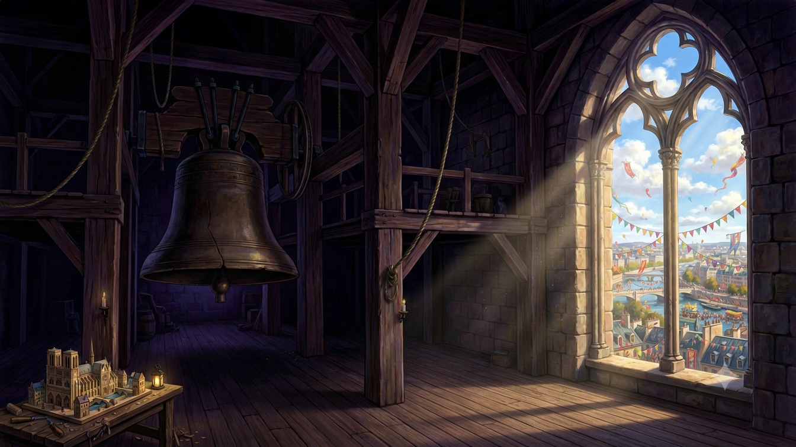

# The Hunchback of Notre Dame

In *The Hunchback of Notre Dame* (1996), directed by Gary Trousdale and Kirk Wise, Quasimodo, who is the film's main character and has a spinal disorder, lives in the Cathedral Notre-Dame's bell tower by Frollo, who is the Minister of Justice and judge in Paris. Quasimodo wants to go outside of the Cathedral Notre-Dame’s bell tower, but Frollo deters him from it. ["Out There"](https://youtu.be/jdIP2xmDqx0?si=uhF88qIoW3JCghnR) is the song that Quasimodo and Frollo sing together in this situation. In the first half of the song, they sing in a majestic and heavy melody with a narrow range, chromatic descent and passing tones. Frollo sings that Quasimodo should not go outside because disorder is a crime and the world would despise him. Because Frollo has suppressed Quasimodo and blamed Quasimodo's disability for a long time, Quasimodo takes blame for his disability for granted and obeys Frollo. Unlike the first half that shows Frollo’s ableism, in the latter part, there is Quasimodo’s monologue part. It sings Quasimodo’s sadness about not going outside of the Cathedral Notre-Dame’s bell tower during his life by Frollo's pressure and fear of people's disdain to Quasimodo's appearance, and his small hope that he wants to stroll the world outside of the Cathedral Notre-Dame’s bell tower. The Latter part is about Quasimodo's hope, so the melody is bright and cheery with melodic leap in wide mdlodic range. With contrast between the first half and the latter part, Quasimodo’s eagerness for hope, which Quasimodo protects with fortitude despite Frollo’s disdain for disability, is emphasized. So, it makes audiences sympathize more with Quasimodo’s illness narrative.
If you read [another writing](./kim-nayoung.md) that has contents about same film and song, analyzed with social dimension, you can understand the film and song more abundantly.

# 노틀담의 꼽추

게리 트라우스데일, 커크 와이즈 감독의《노틀담의 꼽추》(1996)에서, 척추 장애를 가진 주인공 콰지모도는 파리의 영주 겸 판사인 프롤로에 의해 노트르담 대성당의 종탑에서 갇혀 산다. 콰지모도는 종탑 밖으로 나가고 싶어 하지만, 프롤로는 이를 저지한다. 이 상황에서 콰지모도와 프롤로가 함께 부른 노래가 「Out There」이다. 노래 [「Out There」](https://youtu.be/94NNTc44H44?si=li-ICx21taHLR81_) 전반부는 좁은 음역대와 반음계적 하행 및 비화성음을 이용하여 웅장하고 무거운 곡조로 노래가 진행된다. 프롤로는 장애는 죄고, 세상은 장애를 가진 그를 멸시할 것이라며 콰지모도에게 종탑 밖으로 나가지 말라고 명령한다. 프롤로는 오랜시간동안 콰지모도를 억압하고 콰지모도의 장애를 비난했었기에, 콰지모도는 자신의 장애에 대한 비난을 당연시하며 프롤로에게 복종한다. 이처럼 전반부에서는 프롤로의 비장애중심주의적인 시선을 보여준다. 전반부와는 달리, 후반부에서는 프롤로의 강요와 자신의 모습을 사람들의 멸시할 것이라는 두려움에 의해 평생을 종탑 밖으로 나가지 못한 슬픔과 그저 종탑 바깥의 세상을 거닐고 싶어하는 조그마한 소망을 노래하는 콰지모도의 독백이 이어진다. 후반부는 콰지모도의 소망을 노래하는 만큼, 넒은 음역대 사이에서의 음정 도약을 사용하는 밝으면서도 당찬 곡조가 노래를 이끈다. 전반부와 후반부의 대비를 통해, 프롤로의 장애에 대한 멸시에도 콰지모도가 꿋꿋하게 지켜온 소망에 대한 간절함을 강조하여 청중으로 하여금 콰지모도의 질환서사에 더욱 공감할 수 있도록 한다.
같은 작품과 노래를 사회적인 측면으로 바라본 내용이 있는 [글](./kim-nayoung.md)과 함께 읽으면, 해당 작품을 더 풍부하게 이해할 수 있다.

